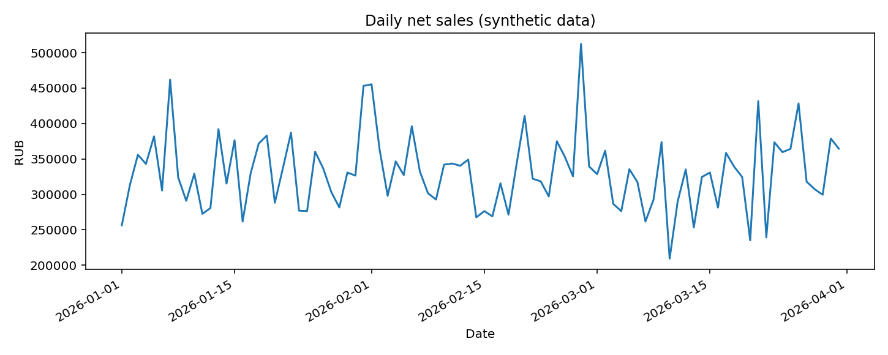
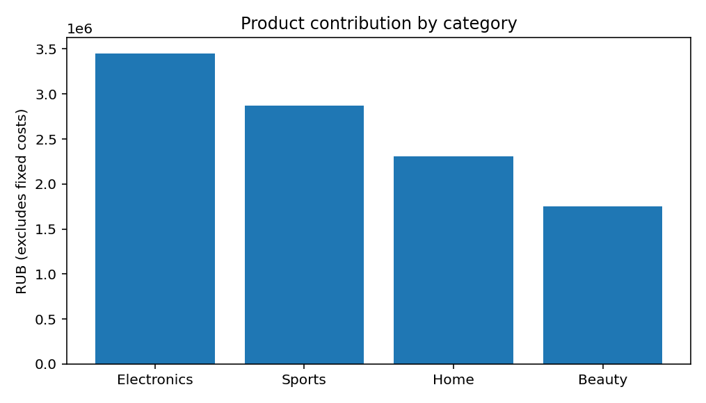

# Sales Analytics Pipeline — SQL + Python + SQLite

**Portfolio project | Data Analyst / Junior Analytics Engineer | Synthetic data**

> This is an educational reproducible simulation, **not** a project performed for a real company. All orders and prices are synthetic. Financial values are illustrative RUB.

## Business question

An online store spends time manually compiling sales reports. Build a repeatable workflow that loads transaction-level orders and a product catalog, validates the records, calculates KPIs using SQL, and exports stakeholder-friendly CSV reports and charts. Use the outputs to identify sales mix and reporting limitations.

## Workflow

`CSV (orders + products) → data quality checks → SQLite → SQL aggregations → CSV reports → charts`

### Analysis results (seed=2026)

- **6,000** orders in the dataset, **5,207** completed, **415** returned, **378** cancelled.
- **29,767,800 RUB** net sales from completed orders, excluding returned/cancelled orders.
- **10,384,430 RUB** product contribution (sales minus product cost, **not net profit**).
- **Electronics** contributes the greatest sales volume at **13,663,300 RUB**.
- **Organic** generates **11,324,700 RUB** of completed-order sales; this does **not** mean it has the best marketing ROI because acquisition costs are absent.

### Plots




## Running locally

Python 3.10+ recommended. Run from the root folder:

```bash
python -m pip install -r requirements.txt
python src/generate_data.py
python src/pipeline.py
python -m pytest -q
```

`src/generate_data.py` recreates CSV inputs with a fixed random seed. `src/pipeline.py` creates a local ignored `sales.sqlite` database, runs SQL and writes CSVs/PNGs. All generated data can be regenerated; you do not need a database server or an account.

## Files

| Path | Purpose |
|---|---|
| `data/` | synthetic orders and product catalog |
| `src/generate_data.py` | deterministic data generation |
| `src/pipeline.py` | validations, SQLite ingestion, aggregation and chart export |
| `sql/metrics.sql` | annotated SQL summary |
| `reports/` | daily/category/channel/status reports and summary |
| `figures/` | plots displayed above |
| `notebooks/walkthrough.ipynb` | read-through of metrics and interpretation |
| `tests/` | smoke/invariant tests |
| `docs/project_story_ru.md` | motivation, speaking points and limitations (RU) |

## Findings and recommended next steps

1. The reporting workflow is reproducible and has checks for duplicate IDs, missing product references and invalid quantities.
2. Electronics drives the largest share of sales, but category contribution (sales minus direct product cost) is more useful than sales alone for comparing the product mix.
3. Organic has the largest sales contribution in absolute value; without marketing spend data, **do not infer channel ROI**.
4. For a real deployment, connect payment/refund events, marketing spend, fulfillment costs and customer-level identities; reconcile totals with financial reporting, implement incremental ingestion and scheduled quality alerts.

## Important limitations

- No real business impact or production deployment is claimed.
- Net sales treats every returned order as fully reversed; partial returns and refund timing are not modeled.
- Product contribution excludes shipping, advertising, salaries, taxes and platform overhead, so it is **not net profit**.
- Channel completion rate is the share of generated orders with status `completed`, **not** visit-to-purchase conversion.
- The synthetic data were generated to demonstrate the analysis; the findings are not causal and should not be presented as discoveries about a real store.

## Resume-ready formulation (accurate)

> Built a reproducible educational sales analytics pipeline on 6,000 synthetic e-commerce orders using Python, SQLite and SQL; automated validation, metric aggregation, CSV reports and visualization; documented metric definitions and business limitations.
